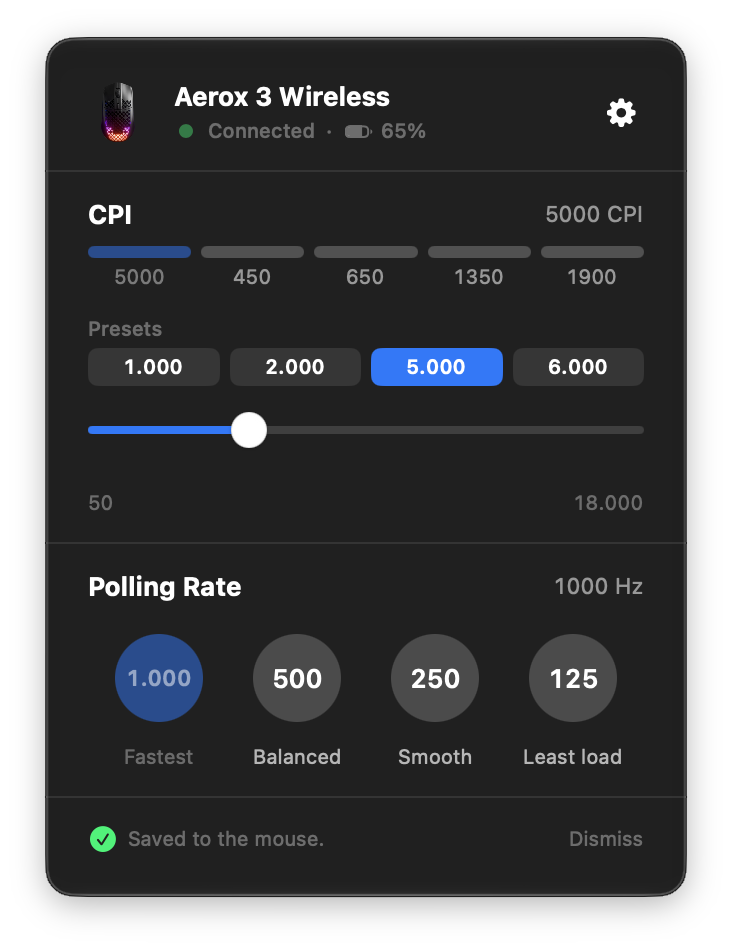
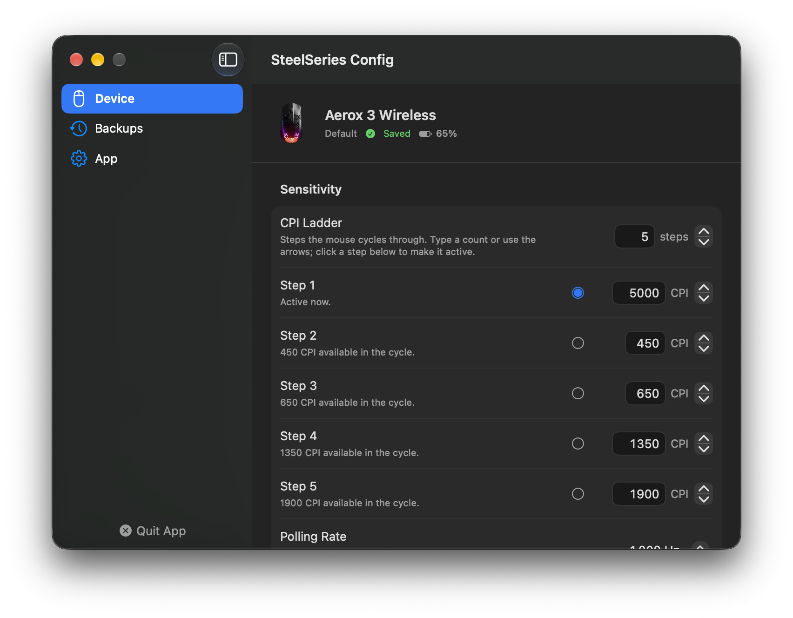
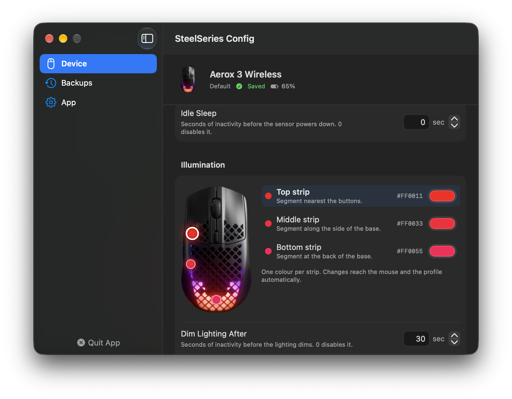
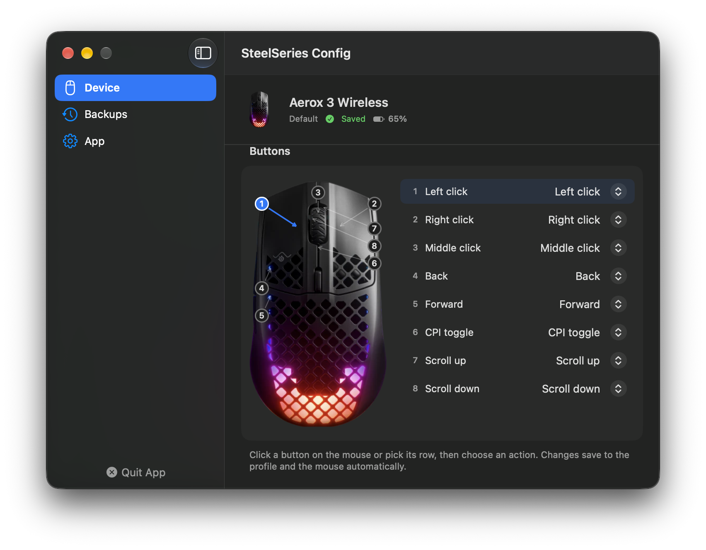
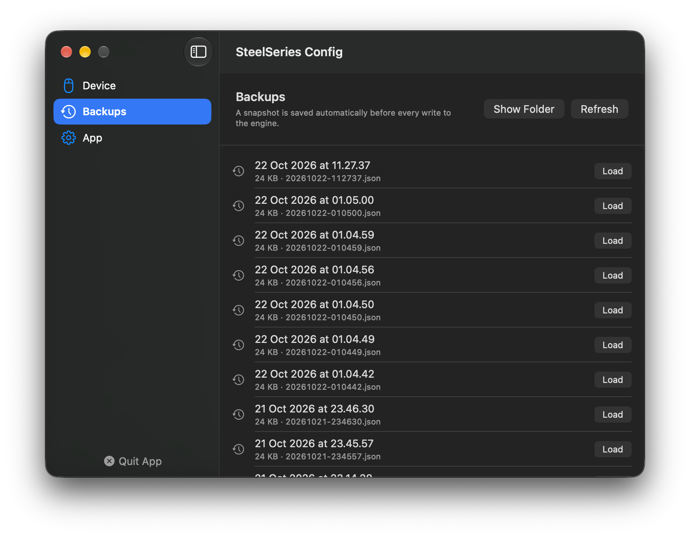
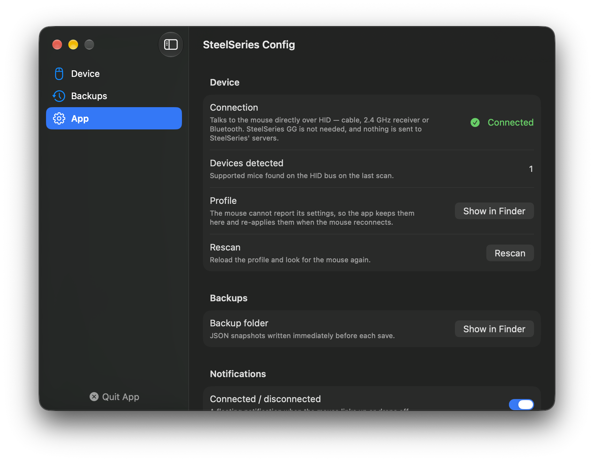

# SteelSeries Config

Unofficial, **standalone** macOS configuration tool for the SteelSeries Aerox 3 Wireless.
It talks to the mouse directly over USB HID. **SteelSeries GG is not needed** and can be
uninstalled.

Menu bar app: click the SteelSeries icon → a popover with CPI presets, the CPI ladder and
polling-rate controls → a Settings window with the full editor (CPI ladder, power,
lighting, buttons, backups). Every edit saves itself: the change is written to the app's
profile and committed to the mouse's onboard memory after a short debounce, with no
Apply step. Illumination and Buttons use mouse previews, so you pick the lighting zone or
the physical button directly instead of matching a row to a shape.

Not affiliated with SteelSeries.

---

## Screenshots

### Menu bar



Clicking the menu bar icon opens the everyday controls: connection and battery state,
CPI presets, the five-step CPI ladder and polling rate. The footer reports the last write
to the mouse.

### Sensitivity



The Device tab opens on the CPI ladder. Up to five steps can be enabled; each step has
its own CPI value and a radio button that makes it the active step. The stepper beside
*CPI Ladder* adds or removes steps. *Polling Rate* selects 1000, 500, 250 or 125 Hz.

### Illumination



The three light strips are edited directly on the mouse preview: click a hotspot or a row,
then pick a colour in the well or type a hex value. Below the zone editor are the shared
lighting options — dim timer, reactive colour, rainbow at startup and reactive lighting.

### Buttons



Every physical control gets a numbered tag connected by a leader line, so each row maps to
a visible part of the mouse instead of an abstract button number. Actions cover the mouse
buttons, the CPI toggle, the scroll wheel and *Disabled*.

### Backups



A JSON snapshot is written automatically before every write to the engine. *Load* restores
a snapshot, *Show Folder* opens the backup directory in Finder, and *Refresh* re-reads it.

### App



The App tab reports the HID connection, the number of supported devices found on the last
scan, the profile and backup locations, notification preferences and the update check.

---

## Why this exists

SteelSeries GG requires an account and ships an Electron UI on top of a native engine.
This app replaces both with a small native menu bar app that speaks the mouse's own HID
protocol.

**No SteelSeries login. No SteelSeries servers. No GG. No Electron.** The app opens no
network connection except the GitHub update check.

## How it works

- **Transport** — `HIDMouseDriver` opens the mouse's vendor interface (interface 3) with
  `IOHIDManager` and writes HID output reports. Over the 2.4 GHz receiver every command
  carries the `0x40` flag on its first byte. Commands are spaced 50 ms apart, as the
  firmware drops commands sent back to back.
- **Protocol** — `AeroxProtocol` holds pure byte encoders, taken from
  [rivalcfg](https://github.com/flozz/rivalcfg)'s Aerox 3 Wireless profile.
  `AeroxProtocolTests` pins every encoder to bytes produced by rivalcfg itself.
- **Profile** — the firmware cannot report its settings back, so the app keeps them in
  `~/Library/Application Support/SteelSeriesConfig/profiles/aerox-3-wireless.json`. On first
  launch the profile is seeded from the newest backup the app took while it still ran on
  GG, so existing tuning carries over; otherwise rivalcfg's defaults are used. When the
  mouse is plugged in or wakes up, the profile is re-sent so the mouse always runs what
  the app shows.
- **Live apply** — edits are debounced (500 ms) and only commands that changed since the
  last send are written, so dragging the CPI slider does not rewrite the button map. The
  same pass persists the profile and commits the changes to the mouse's flash.
- **Status** — presence comes from the HID bus. Over the receiver, the battery query
  (`0x92`) doubles as the link check: no answer means the mouse is off or out of range.

| Setting | Command | Payload |
|---|---|---|
| CPI ladder | `2D` | count, active index, one sensor code per step (100…18000, step 100) |
| Polling rate | `2B` | 1000 / 500 / 250 / 125 Hz → `00 / 01 / 02 / 03` |
| Sleep timer | `29` | milliseconds, 3 bytes little-endian (max 20 min) |
| Dim timer | `23 0F 01 00 00` | milliseconds, 3 bytes little-endian (max 20 min) |
| Reactive colour | `26` | `01 00 R G B`, or `00 ×5` for off |
| Startup lighting | `27` | rainbow, reactive (one byte each) |
| Zone colour (top / middle / bottom) | `21 01 00/01/02` | `R G B` per strip segment |
| Buttons | `2A` | 8 × 5-byte slots: B1–B6, scroll up, scroll down |
| Battery | `92` | reply byte 1: bit 7 charging, level `((b & 0x7F) − 1) × 5` |
| Save to flash | `11 00` | — |

## Safety model

| Guarantee | Where | What it blocks |
|---|---|---|
| Validated writes | `WriteSafetyPolicy` | Empty, non-JSON, non-object or suspiciously shrunk documents are rejected before the profile is written. |
| Automatic pre-save backup | `BackupStore` | The profile is snapshotted to `~/Library/Application Support/SteelSeriesConfig/backups/` before every save. |
| No guessed codes | `AeroxProtocol.buttons` | A button action the firmware does not know is never sent; the slot keeps its factory action. |
| Status-only feedback | `BarActionsView` | A skipped or failed write is reported instead of pretending the edit reached the mouse. |
| Unparseable profile ⇒ read-only | `ConfigurationStore.apply()` | The UI stays visible but every control is disabled rather than editing a document it does not understand. |

## Architecture

```
SteelSeriesConfig/
├── SSConfigApp.swift              App + AppDelegate, Settings window scene
├── Models/
│   ├── AnyJSONValue.swift         Untyped JSON tree; preserves unknown keys verbatim
│   ├── MouseSettings.swift        Typed accessors over the profile document
│   ├── Device.swift               The attached mouse
│   ├── DeviceConfiguration.swift  Profile document container
│   └── DeviceLinkState.swift      LinkPhase, BatteryStatus
├── Services/
│   ├── AeroxProtocol.swift        Pure byte encoders/decoders for the mouse
│   ├── HIDMouseDriver.swift       IOKit HID transport
│   ├── LocalProfileStore.swift    Profile file on disk
│   ├── ConfigurationStore.swift   @MainActor @Observable orchestration, polling, live apply
│   ├── WriteSafetyPolicy.swift    Pre-write validation
│   ├── BackupStore.swift          Pre-save snapshots
│   └── HostBatteryReader.swift    macOS Bluetooth battery parser
├── Resources/
│   ├── sse3.icns                  App icon (from SteelSeries GG)
│   ├── StatusBarIcon(@2x).png     Menu bar template icon (from SteelSeries GG)
│   └── DeviceAerox3*.png          Product artwork (GG `loadoutImages/devices/aerox_3*.webp`)
├── Views/
│   ├── Bar/                       Menu bar popover
│   └── Settings/                  Device editor, backups, app info
└── Utils/
    └── StatusBarController.swift  NSStatusItem + non-activating NSPanel
```

## Building

Requires Xcode 16+ and [XcodeGen](https://github.com/yonaskolb/XcodeGen).

```sh
brew install xcodegen
xcodegen generate
xcodebuild -project SteelSeriesConfig.xcodeproj \
           -scheme SteelSeriesConfig \
           -configuration Release \
           build
```

The Release build is signed ad-hoc (`CODE_SIGN_IDENTITY: "-"`), which is enough to run on
the machine that built it. A stable Development identity also works and is preferable if
you reinstall often: ad-hoc signatures change identity on every build, which resets the
Input Monitoring grant. Copy `SteelSeriesConfig.app` from the build products into
`/Applications` to install it.

### Releases and in-app updates

Every push to `main` runs `.github/workflows/build.yml` on a macOS runner with Xcode. The
run executes the unit tests, builds the Release app, and publishes it as a GitHub release
tagged `build-<run number>`. The release carries a DMG (drag the app onto *Applications*)
and a SHA-256 checksum, and its notes list the commits since the previous release. The
build number is written into `CFBundleVersion`. A local build reports build `0` and never
updates itself, so a published release cannot overwrite work in progress.

The app checks that release every six hours, and on demand from *Settings → App → Check
Now*. A newer build is downloaded in the background, checked against its published
checksum, and its code signature is verified. Nothing is replaced until you press
**Install & Relaunch**, and that button stays disabled while a save is running or edits are
unsaved.

The build is ad-hoc signed and not notarized, so macOS blocks the first launch of a copy
downloaded in a browser. Right-click the app and choose *Open*, or run
`xattr -dr com.apple.quarantine /Applications/SteelSeriesConfig.app`. Updates installed from
inside the app do not need this.

### Tests

```sh
xcodebuild -project SteelSeriesConfig.xcodeproj -scheme SteelSeriesConfig test
```

`AeroxProtocolTests` compares every encoder against bytes generated by rivalcfg
(`pip install rivalcfg`), so a change that alters the wire format fails the suite. The
remaining tests cover the settings document model, write-safety rules, backups and
release-manifest parsing. No test needs a mouse attached.

## Requirements

- macOS 14.0 or later.
- An Aerox 3 Wireless (or the CS2 Dragon Lore edition) connected by USB cable, its 2.4 GHz
  receiver, or Bluetooth LE.

## Limitations

- **Per-zone colours are new.** The three strip segments use rivalcfg's `21 01 <zone>`
  command, but the write has not been confirmed on a physical mouse yet. The other
  commands match rivalcfg and are in daily use.
- **Bluetooth needs Input Monitoring.** Over Bluetooth LE the mouse appears as one HID
  device (vendor id `0x0111`) that also carries a keyboard collection, so macOS only lets
  the app write to it after *System Settings → Privacy & Security → Input Monitoring* is
  granted. The app asks once. Writes over Bluetooth use the vendor collection's report id
  4 and are the least verified path; cable or receiver is the reference.
- **Aerox 3 Wireless only.** Other models need their own command table.
- **Settings the protocol cannot express are hidden**, not faked: angle snapping, Exact
  Aim/Accel, Low-Power Gaming Mode, brightness, Smart Lighting and Bluetooth mode.
  Button remapping covers mouse buttons, the CPI toggle, the scroll wheel and *Disabled*.
- **No macro editor.** GG's macro and keyboard-key actions need a keycode table and macro
  format that rivalcfg does not document; the app does not ship a fake version of either.
- **Settings cannot be read back.** If another tool reprogrammes the mouse, the app does
  not notice until it next re-sends the profile (on reconnect or wake).

## Provenance

The HID protocol comes from [rivalcfg](https://github.com/flozz/rivalcfg) (WTFPL) by
Fabien Loison and contributors. The settings document layout was originally taken from
the SteelSeries GG client, which this app no longer needs. The app icon, menu bar glyph
and product artwork are SteelSeries' own assets, copied from the GG bundle; they are
trademarks of SteelSeries and are not covered by this project's licence.

The UI follows the menu-bar-popover pattern of
[nothing-bar](https://github.com/bestK1ngArthur/nothing-bar): a borderless non-activating
`NSPanel` with a glass backdrop, a 320 pt control column, and a separate Settings window
with a sidebar. Credit for that structure belongs to its author.

## License

MIT.
